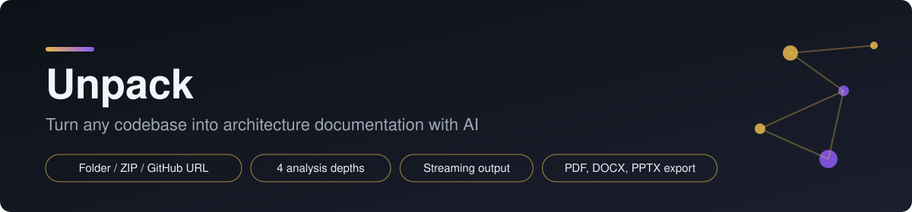
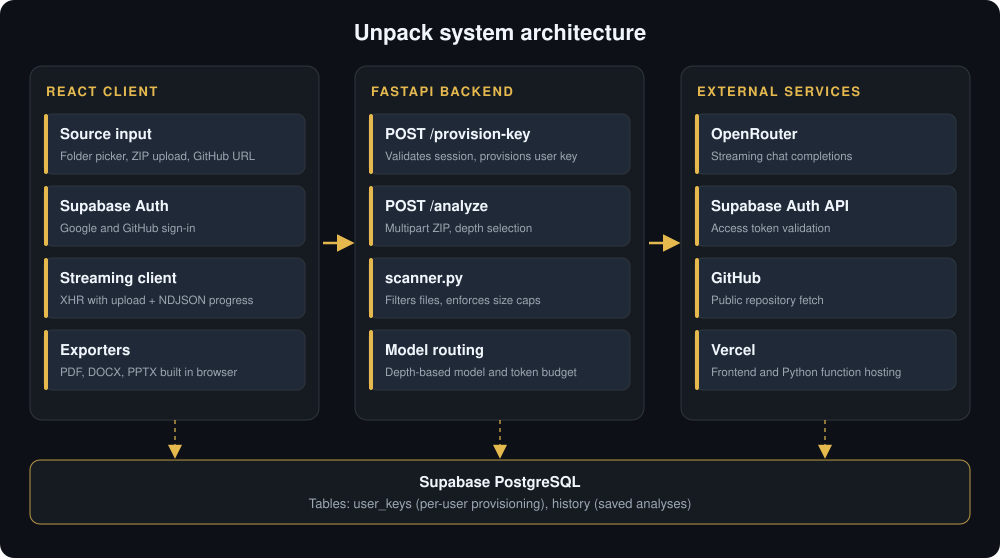

<p align="center">
  
</p>

<p align="center">
  <a href="https://unpack-tau.vercel.app/"><b>Live Demo</b></a>
  &nbsp;|&nbsp;
  <a href="#architecture">Architecture</a>
  &nbsp;|&nbsp;
  <a href="#analysis-depths">Analysis Depths</a>
  &nbsp;|&nbsp;
  <a href="#getting-started">Getting Started</a>
</p>

<p align="center">
  
  
  
  
  
</p>

# Unpack

Unpack reads a codebase and writes the documentation for it. Give it a folder, a ZIP archive or a public GitHub URL and it returns an architecture breakdown, tech stack summary, data model and technical debt review, streamed live and exportable as PDF, DOCX or PPTX.

---

## Features

| Area | Details |
|---|---|
| Three input paths | Pick a local folder, upload a ZIP, or paste a public GitHub repository URL. |
| Client-side prefiltering | Folders and ZIPs are filtered in the browser before upload, which keeps requests small. |
| Smart scanner | A backend scanner drops build artifacts, binaries and lockfiles, ranks files by importance and enforces size caps before anything reaches the model. |
| Four analysis depths | Choose how much detail you want, from a quick summary to a full forensic audit. |
| Live streaming | Results arrive as newline-delimited JSON events with progress, keep-alive pings and the final Markdown report. |
| Per-user model access | Signing in provisions a $0-capped OpenRouter key for that user, so analyses run on free models. |
| Exports | PDF, DOCX and PPTX are generated in the browser with consistent branding, watermark and page numbers. |
| History | In persistent mode, finished analyses are saved to Supabase and can be reopened later. Temporary mode saves nothing. |
| Interface | Day-to-night theme slider, guided tour, contact menu and a responsive layout. |

---

## Architecture

<p align="center">
  
</p>

### Request flow

1. **Sign in.** The user authenticates with Google or GitHub through Supabase Auth.
2. **Provision.** The client calls `POST /provision-key` with the access token. The backend validates it against Supabase, creates a $0-capped OpenRouter key if none exists and records it.
3. **Acquire source.** The client builds a filtered ZIP from a folder or archive, or the backend fetches the GitHub repository.
4. **Scan.** `POST /analyze` extracts the archive and `scanner.process_codebase` filters and ranks files within the size limits.
5. **Analyze.** The backend picks a model and prompt for the chosen depth and streams the completion from OpenRouter, emitting `delta`, `ping`, `done` and `error` events. Inference runs in a thread pool so the server stays responsive.
6. **Render and export.** The client renders the Markdown, optionally saves it to history, and exports to PDF, DOCX or PPTX locally with no server round trip.

### Why the scanner matters

A raw repository can contain millions of tokens of dependencies, build output and generated files, far beyond any model context window. The scanner removes ignored directories, files and extensions, skips oversized files and caps total input (`MAX_FILE_BYTES`, `MAX_RAW_BYTES`, `MAX_CODEBASE_CHARS`). In testing it cut one large raw repository from about 6.45M tokens to about 125K.

---

## Analysis Depths

| Depth | Name in UI | Intended use |
|---|---|---|
| `minimal` | Quick Summary | A fast overview of what the project does |
| `medium` | Standard Architecture | Structure, stack, data flow and key components |
| `everything` | Deep Dive | Full architecture, schema, features and file breakdown |
| `diagnose` | Diagnose | Forensic review of security and technical debt |

Each depth has its own prompt and token budget.

---

## Tech Stack

| Layer | Technology |
|---|---|
| Frontend | React 19, Vite, react-markdown, JSZip |
| Exports | jsPDF, docx, pptxgenjs |
| Backend | Python 3.10+, FastAPI, Uvicorn, python-multipart |
| AI | OpenRouter (streaming chat completions) |
| Auth and data | Supabase Auth, Supabase PostgreSQL |
| Hosting | Vercel (static frontend and Python serverless function) |

---

## Data Model

**`user_keys`** stores per-user provisioning: `user_id` (primary key, one row per user), `email`, a key hash for revocation checks and `created_at`.

**`history`** stores saved analyses: `id`, `user_id`, `project_name`, `analysis_level`, `summary` (the Markdown report), `created_at`, with an index on `user_id`.

---

## Project Structure

```
backend/
  main.py            FastAPI app, auth, provisioning, streaming analysis
  scanner.py         File filtering, ranking and size limits
  requirements.txt
  vercel.json
frontend/
  src/
    App.jsx          Shell, theme slider, session handling
    Login.jsx        Google and GitHub sign-in
    Workspace.jsx    Source selection, depth picker, results, history
    Tour.jsx         Guided onboarding
    analyzeClient.js XHR client for upload progress and NDJSON streaming
    exporters.js     Markdown parser and PDF, DOCX, PPTX generators
    supabase.js      Supabase client and provisioning call
```

---

## Getting Started

**Prerequisites:** Python 3.10+, Node.js 18+, a Supabase project and an OpenRouter account with a management key.

**1. Configure the backend.** Create `backend/.env`:

```env
SUPABASE_URL=https://your-project.supabase.co
SUPABASE_SERVICE_ROLE_KEY=your_service_role_key
OPENROUTER_MANAGEMENT_KEY=your_management_key
FRONTEND_ORIGINS=http://localhost:5173
```

**2. Configure the frontend.** Create `frontend/.env`:

```env
VITE_SUPABASE_URL=https://your-project.supabase.co
VITE_SUPABASE_ANON_KEY=your_anon_key
VITE_API_URL=http://localhost:8000
```

**3. Run the backend.**

```bash
cd backend
pip install -r requirements.txt
uvicorn main:app --port 8000 --reload
```

**4. Run the frontend.**

```bash
cd frontend
npm install
npm run dev
```

Open `http://localhost:5173`. Create the `user_keys` and `history` tables in Supabase before the first run.

---

## Roadmap

- Add rate limiting to `/provision-key` and `/analyze`.
- Add a test suite for the scanner filters and the streaming parser.
- Redact likely secrets from source files before they are sent to a model.
- Move model preferences to configuration so a model outage does not need a redeploy.
- Split the export module so each format loads on demand.

---

## Author

**Nartan Maruti Naik**
[GitHub](https://github.com/NartanNaik) | [LinkedIn](https://www.linkedin.com/in/nartan-naik-90499a359/) | naiknartana@gmail.com